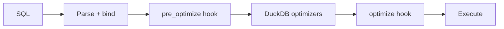
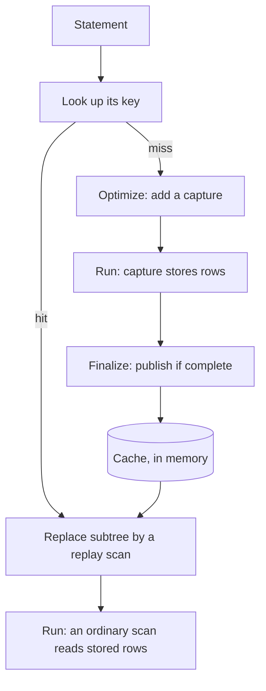

# Query Recycling in DuckDB

A DuckDB extension (`waddle`) that **recycles query results**. It remembers intermediate results from earlier queries and replays them when the same work shows up again, so repeated and near-repeated queries skip their joins, aggregates and sorts.

Built by Group 15 for the *Data Systems Architecture* course (Assignment 2) against **DuckDB v1.5.5** and the IMDB (JOB) dataset.

**Correctness first: we reuse only what is provably the same.** Every one of the 149 public queries returns the same answer as stock DuckDB, and anything that can't be keyed exactly simply runs as in vanilla DuckDB.

- [Results](#results)
- [Why recycling](#why-recycling)
- [Architecture](#architecture)
- [Exact reuse](#exact-reuse)
- [Partial reuse: blocks and ranges](#partial-reuse-blocks-and-ranges)
- [The cache](#the-cache)
- [What is never reused](#what-is-never-reused)
- [Using it](#using-it)
- [Testing strategy](#testing-strategy)
- [Build, test, benchmark](#build-test-benchmark)
- [Takeaways](#takeaways)
- [How and why we used AI](#how-and-why-we-used-ai)
- [References](#references)

## Results

### Whole workload

Geometric-mean query time over the 149 public queries, fastest of 3 runs (lower is better). Each row adds one mechanism on top of the previous one.

| Configuration | What it reuses | Geo-mean per query | Speed-up vs stock |
|---|---|---|---|
| Stock DuckDB v1.5.5, no extension | nothing | 42.1 ms | baseline |
| + Pipeline breakers | aggregates, joins, DISTINCT, CTEs | 33.7 ms | 1.2x |
| + Whole queries | repeats, drill-downs, pages | 18.5 ms | 2.3x |
| + Blocks and ranges | same joins, other columns or dates | 5.9 ms | **7.2x** |

The last step, blocks and ranges, takes the geometric mean from 18.5 ms to 5.9 ms, a further 3.1x on top of everything before it. The joins and filters in the middle of a query gave the biggest saving.

### Exact reuse, per technique

| Technique | Example | Stock DuckDB | Recycled |
|---|---|---|---|
| Whole statement | dashboard refresh | 1,133 ms | 0.2 ms |
| Subquery equal to an earlier statement | drill-down (q0233) | 292 ms | about 1 ms |
| Next page of a sorted list | `LIMIT 100 OFFSET 100` | 735 ms | under 1 ms |

### Partial reuse, per tile

Four dashboard tiles share one expensive five-table join. Stock DuckDB takes **0.9-1.4 s per tile** on the same machine. Once the block is stored, a tile takes **7-17 ms**.

| GB dashboard | Tile | Time | What happened |
|---|---|---|---|
| q0226 | name | 174 ms | joins ran (rows counted) |
| q0227 | gender | 191 ms | joins ran (block stored) |
| q0228 | role | 9 ms | block replayed |
| q0229 | year | 15 ms | block replayed |
| q0234 | year 2010 only | 17 ms | block replayed, then filtered |

| Canada dashboard | Tile | Time | What happened |
|---|---|---|---|
| q0235 | name | 165 ms | joins ran (rows counted) |
| q0236 | gender | 214 ms | joins ran (block stored) |
| q0237 | role | 7 ms | block replayed |
| q0238 | year | 12 ms | block replayed |

> All timings are local runs with the course grader's settings (`threads = 6`, `memory_limit = '8000MB'`, `preserve_insertion_order = false`) on the **public** query stream, in order. They are not official leaderboard scores. The workload repeats queries by design, so these numbers show how well recycling works when queries repeat, not how it behaves when they don't.

## Why recycling

Analytical workloads repeat themselves. On half of all Amazon Redshift clusters, 80% of queries repeat an earlier one (Saxena et al., 2024). Dashboards re-issue the same or similar queries, and data agents explore a dataset incrementally. Standard benchmarks such as TPC-H and TPC-DS contain no repeats, and stock DuckDB is not tuned for them.

Naively caching every result fills memory fast and can force materialization where DuckDB would have streamed. So the hard part is deciding **what to store, when it is safe to reuse, and what is not worth keeping**.

## Architecture

The extension hooks into DuckDB twice, before and after DuckDB's own optimizers:



**pre_optimize hook** (keys are taken here, before DuckDB rewrites the plan):

1. Remove unused LEFT JOINs (a rewrite, not recycling)
2. Look up the whole statement: on a hit, replay it; on a miss, remember its key
3. Look up pages and subqueries that repeat an earlier statement
4. Mark each block: replay it, count its rows, or capture it
5. Remove EXISTS DELIM joins (a rewrite, not recycling)

**optimize hook:**

1. Unmark filtered blocks (no capture, no count)
2. Pipeline breakers: on a hit, replay; on a miss, capture
3. Capture the final result (outermost, last step)

DuckDB then builds the physical plan, and each capture becomes a sink operator.

### Capture and replay



A miss captures rows as the query runs, and a result is published only when it is complete. A later hit replaces the matching subtree with a replay scan.

### Code layout

A thin layer touches DuckDB, and the logic that doesn't need it is plain C++:

- **DuckDB-facing code:** `recycling_adapter.cpp` (the front door), pipeline breakers, blocks, plan rewrites, operators, plan keys, recycling state, settings and per-client state
- **Plain C++, no DuckDB dependency:** `recycling_key` and `recycling_cache`

Other directories: `src/` (extension), `test/` (SQL tests), `benchmark/` (public query set), `scripts/` (data download, benchmark runner).

## Exact reuse

### From a query plan to a key

A result is stored under a **key**: the serialized bound plan. Equal keys mean equal plans, which mean equal results. Keys are compared as whole strings, with no "similar enough" matching.

```sql
SELECT kind_id, count(*) AS n
FROM title
WHERE year > 2000
GROUP BY kind_id;
```

After binding, the plan is `PROJECTION #1 -> AGGREGATE #2 #3 #4 -> FILTER year > 2000 -> SCAN title #0`, where `#n` are table IDs handed out in binding order. Our serializer walks every field of the plan and writes a key of this shape:

```
query: {PROJECTION 1 {AGGREGATE 2 3 4 {FILTER 2000 {SCAN title 0 }}}}
```

A real key for a query this small is about 1,900 bytes, because every field is written.

### Making the key stable

**Table IDs are renumbered in order of first appearance.** The same plan gets different raw IDs depending on what was bound first, so the key writes the first new ID as 0, the next new one as 1, and an ID seen again keeps its number:

| | IDs |
|---|---|
| alone (depends on what was bound first) | 0 0 2 3 4 0 1 2 3 |
| inside a join (every ID shifted by one) | 1 1 3 4 5 1 2 3 4 |
| **written in the key** | **0 0 1 2 3 0 4 1 2** (identical, so the same key) |

**Text positions are written as 0.** They are only used for error messages, but spacing, line breaks or being wrapped in another query move them:

```sql
SELECT kind_idd FROM title;          -- error position 7
SELECT      kind_idd FROM title;     -- error position 12
```

### Finding an earlier query inside a new one

q0231 misses (1,191 ms): its whole result (`ORDER BY year, role, gender` over a `GROUP BY year, role, gender` over 5 joins with `EXISTS '[gb]'`) is captured and stored under key K.

q0233 uses q0231 word for word as a subquery, with `FILTER role = 'actress'` and `ORDER BY d.year, d.gender` on top. The subquery gets key K after normalising, so it hits: a replay scan of 2,965 rows replaces it, and the query takes about 1 ms instead of 292 ms on stock DuckDB.

**Why the key is taken before DuckDB's optimizers:** filter pushdown would push `role = 'actress'` inside the subquery, so the subtree would no longer be q0231 exactly. Its key K' would differ from K, and the lookup would miss.

### The next page of a sorted list

| Page | Query | Result |
|---|---|---|
| Page 1 | `ORDER BY name LIMIT 100 OFFSET 0` | miss: it runs, and keeps the first 1,024 sorted rows |
| Page 2 | `... LIMIT 100 OFFSET 100` | hit: 735 ms to under 1 ms, cut from the stored rows with no scan, join or sort |
| Page 11 | `... LIMIT 100 OFFSET 1000` | needs 1,100 rows, more than the 1,024 stored: miss. It runs normally and keeps 4 x 1,100 = 4,400 rows, so the next pages hit again |

The sort runs anyway; we keep `max(4 x (offset + limit), 1024)` rows of it, then cut the page. Every page has the **same key**: the key of the sorted list, without LIMIT and OFFSET.

### Where keys are used

| Hook | What gets a key | Examples |
|---|---|---|
| pre_optimize | the whole statement; a subquery equal to an earlier statement; the next page of a sorted list | refresh 1,133 to 0.2 ms; drill-down 292 to about 1 ms; next page 735 to under 1 ms |
| optimize | pipeline breakers: aggregate (GROUP BY), DISTINCT, hash-join build side, a CTE used twice | on a hit: replay; on a miss: capture |

Statements with `random()`, `now()`, parameters, temporary tables or files get no key and run exactly as in vanilla DuckDB.

### One query, run twice

```sql
SELECT kt.kind, count(*) AS movies
FROM title t
JOIN kind_type kt ON t.kind_id = kt.id
WHERE t.production_year >= 2000
GROUP BY kt.kind
ORDER BY movies DESC;
```

| kind | movies |
|---|---|
| episode | 957,299 |
| movie | 282,115 |
| video movie | 91,220 |
| tv series | 51,530 |
| tv movie | 46,559 |
| video game | 5,743 |

**Run 1 (miss, 6-8 ms):** capture of the whole result, then ORDER BY, a capture of the aggregate, HASH GROUP BY, a block marker, HASH JOIN (1.4 M rows) with SCAN title (capturing the build side) and SCAN kind_type.

**Run 2 (hit, under 0.5 ms):** a single `waddle_replay` scan returning the same 6 rows from the cache. No join, no aggregate, no sort.

## Partial reuse: blocks and ranges

### Four tiles share one expensive middle

| Tile | Shows | Aggregate |
|---|---|---|
| q0226 | top people by credits | by name |
| q0227 | people by gender | by gender |
| q0228 | credits by role | by role |
| q0229 | people by year | by year |

All four share the same middle: `FILTER` (years 2008-2013, six kinds, `EXISTS` a British company) over a five-table `JOIN` (`cast_info`, `title`, `kind_type`, `name`, `role_type`). Each groups by something else, so they share no aggregate and therefore no exact key. Without blocks, the five-way join runs four times.

### What a block is

A **block** is the joins and filters under the select list:

- it is the child of a projection or an aggregate
- its top is a filter, a join or a cross product
- it contains at least one join (only the outermost block counts)
- it is found in the first hook, before DuckDB's optimizers, and marked with `WADDLE_BLOCK`

### One block, three keys

| Key | What it is | For the GB tiles |
|---|---|---|
| block key | base + ranges: what a result is stored under | joins, filters, `'[gb]'` + year in [2008, 2013] |
| base | the block without its ranges | joins, filters, `'[gb]'` |
| family | the base with every constant removed | joins, filters, `?` |

- **Scans are keyed by table**, not by the columns a tile reads, so q0227 and q0228 share one key.
- **A range** is an integer or date column within constant bounds, in the block's own WHERE.
- **`'[gb]'` stays in the base.** It is a string inside the `EXISTS`. GB and Canada give two bases but one family.

### Count first, store on repeat, then replay

| Tile | Step | Why |
|---|---|---|
| q0226 (name) | **count rows** | new key: runs normally while its rows are counted |
| q0227 (gender) | **capture** | same key again, and the count says it fits |
| q0228 (role) | **replay** | `role_type` is tiny, so it was kept whole |
| q0229 (year) | **replay** | the year is the range column, always kept |
| q0234 (2010) | **replay + filter** | 2010 lies inside the stored 2008-2013 |

What q0227 stores (GB, 2008-2013):

| Column | Why it is kept |
|---|---|
| `n.name` | read by the family (q0226) |
| `n.gender`, `ci.person_id` | read by this statement |
| `t.production_year` | a range column |
| all of `role_type`, `kind_type` | tiny tables (1,000 rows or fewer) |

**Why count before storing?** DuckDB's row estimates for some blocks were up to **126 times too low**. A block is stored only if it fits a quarter of the 2 GiB cache. Counting costs one addition per chunk of rows, so a miss is never much slower than stock. Keeping the tiny tables roughly doubles the row width here, and the block must still fit.

### A narrower range replays a wider block

Say q0227 stored 2008-2013 and q0234 asks for 2010 only:

1. **Same base.** q0234's own key misses, so we look at stored blocks with the same base, newest first.
2. **Ranges contain ours.** 2010 lies inside 2008-2013 (open and closed ends are compared exactly).
3. **Replay, then filter.** The stored rows replay, and q0234's own condition keeps only 2010.

### Two details keep the answers right

- **The marker keeps the aggregate's key stable.** A pipeline breaker above a block describes it by its key and the columns it reads, so its key is the same whether the block runs, is stored or is replayed.
- **An outside filter switches reuse off.** A filter just above a block may be moved into the joins by DuckDB's join ordering. Then the block is not stored, not counted and not keyed. The query itself stays correct; we only give up reusing that block (`recycling_block_outside_filter.test`).

## The cache

One cache serves every connection: **2 GiB, least-recently-used eviction**, and no single result may take more than **a quarter** of the budget (512 MiB). A result over a quarter is refused, and remembered, so it is never copied again.

**Writes.** A committed write wipes the whole cache. A `ROLLBACK` changed no data, so it wipes nothing. While a write is in flight, nothing is replayed or captured.

**Not persisted.** Recycled results live in memory only and are never written to the database file (`imdb.duckdb` is read by every run). Each run is its own process and starts with an empty cache:

| Run | Process | Recycled results |
|---|---|---|
| Warm-up run | process 1 | in memory only |
| Timed run 1 | process 2 | start empty again |
| Timed run 2 | process 3 | start empty again |

Nothing is carried over between runs.

## What is never reused

**Not safe to reuse:**

| What | Why |
|---|---|
| Volatile functions: `random()`, `now()`, sequences | the answer can change on every call |
| Prepared-statement parameters | the result depends on the value bound at run time |
| Temp tables | writes to them don't wipe the cache |
| External scans: files, other catalogs | they can change without a commit we see |
| CTE references, correlated subqueries | their rows come from outside the subtree |
| `ORDER BY`, `LIMIT`, Top-N, windows inside a plan | their output depends on row order |
| Anything we can't key exactly | counted as "unsupported" |

**Not worth storing:**

| What | Why |
|---|---|
| Plain scans and filters | rescanning with zone maps is about as fast |
| A whole large table as a join build side | it already runs on every thread |
| Results over a quarter of the budget | refused, and remembered so they aren't copied again |
| A breaker nearly as big as its captured block | storing both would cost twice |
| A block seen only once | captured only once its family repeats |

Every skip is counted by its reason in `waddle_recycling_stats()`.

## Using it

```sql
SET waddle_recycling = true;      -- recycling on (false = stock behaviour)

-- run the query twice: 6-8 ms the first time, under 0.5 ms the second
SELECT kt.kind, count(*) AS movies
FROM title t JOIN kind_type kt ON t.kind_id = kt.id
WHERE t.production_year >= 2000
GROUP BY kt.kind
ORDER BY movies DESC;

SELECT hits, captures FROM waddle_recycling_stats();   -- also counts skips by reason
```

## Testing strategy

Four layers, from seconds to minutes. One mechanism takes seconds to run; the whole workload and beyond takes minutes.

| Layer | What it covers | Files |
|---|---|---|
| 1. Per mechanism | 40 files, about 500 queries, one file per feature or design decision (ADR). Checks answers and counters, including NULLs, empty input and casts | `recycling_*.test` |
| 2. DuckDB's own checks | `enable_verification` plans each query several ways; 1 and 6 threads give the same rows; concurrent writes never produce stale results | `recycling_verification.test` |
| 3. Whole workload | the 149 public queries against vanilla DuckDB, run twice so the second pass replays. Results must match exactly by md5, with a 1% tolerance for floats, and row count only for LIMIT ties | `benchmark_twice.test` |
| 4. Beyond the public set | fuzzed dashboard variants; every bug gets a regression test; refactors must give the same answers; performance follows the leaderboard protocol | `scripts/benchmark.py` |

The core semantic test records vanilla DuckDB's answer with recycling off, runs the same query twice with recycling on (a capture, then a replay), checks the rows are identical, and checks the counters show 1 hit and 1 capture. Simplified from `test/sql/recycling_semantics.test`:

```
SET waddle_recycling = false;
query II rowsort sums -- record vanilla
SELECT k, sum(v) FROM t GROUP BY k;

SET waddle_recycling = true;
loop i 0 2 -- capture, replay
query II rowsort sums -- same label
SELECT k, sum(v) FROM t GROUP BY k;
endloop

query II
SELECT hits, captures FROM waddle_recycling_stats();
---- 1 1
```

## Build, test, benchmark

```bash
git clone --recurse-submodules https://github.com/sidsbgithub/DuckDB-Query-Optimiser.git
cd DuckDB-Query-Optimiser

python3 ./scripts/download-imdb.py     # IMDB (JOB) dataset -> data/imdb.duckdb
make                                   # build/release/duckdb + the extension
IMDB_DATA=1 make test                  # SQL tests, including every public query vs vanilla DuckDB
make benchmark                         # public workload, same settings as the course grader
```

The benchmark runs the query set twice, scores each run by the geometric mean of its query times, and the faster run counts. DuckDB is pinned to v1.5.5 via `duckdb_version` in `.github/workflows/MainDistributionPipeline.yml`, and an extension only loads into the version it was built against. `docs/README.md` is the upstream extension-template documentation.

## Takeaways

- **Correctness first:** we reuse only what is provably the same.
- **The more of a query we can reuse, the more we save.**
- **Its middle, the joins and filters, gave the biggest saving.**

## How and why we used AI

Coding agents drafted and reviewed much of the code, and the repository keeps their instructions (`AGENTS.md`, `CLAUDE.md`, `.agents/skills`). We checked every change ourselves: SQL tests against stock answers, answer checks across workloads, and timing runs. We kept only what measurements justified, and reverted code that answered queries wrongly.

## References

- Nagel, Boncz, Viglas. *Recycling in pipelined query evaluation.* ICDE 2013.
- Dursun, Binnig, Cetintemel, Kraska. *Revisiting reuse in main memory database systems.* SIGMOD 2017.
- Zhou, Larson, Freytag, Lehner. *Efficient exploitation of similar subexpressions for query processing.* SIGMOD 2007.
- Jindal, Karanasos, Rao, Patel. *Selecting subexpressions to materialize at datacenter scale.* PVLDB 11(7), 2018.
- Saxena et al. *Why TPC Is Not Enough: An Analysis of the Amazon Redshift Fleet.* PVLDB 17(11), 2024.

## License

MIT. See [`LICENSE`](LICENSE). Built on the course's DuckDB extension template, which is where the `waddle` name comes from.
